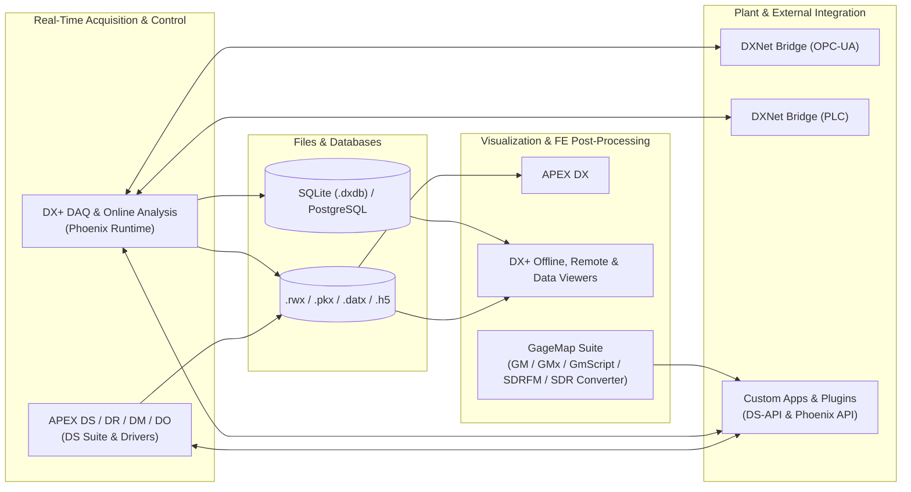

# APEX Turbine Documentation (`ApexDocs`)

Welcome to the unified user and developer documentation portal for **APEX Turbine Testing Technologies** software, hardware drivers, engineering analysis suites, and custom SDKs.

> [!NOTE]
> Browse the full structured index in **[Master Table of Contents (TOC)](TOC.md)**, or jump directly to any product suite, API reference, or deployment guide below.

---

## Documentation Suites

| Suite / Section | Description | Hosting | Entry Point |
| :--- | :--- | :--- | :--- |
| **DS — Data Acquisition Suite** | Synchronized high-speed acquisition (`DS`), remote monitoring (`DR`), distributed cluster CLI/automation (`DM`), analog DAC replay (`DO`), and `30+` hardware device drivers (`Drivers`). | Standalone | [DS Documentation](DS/README.md) |
| **DX — Data Explorer** | High-speed post-test dynamic signal explorer, visual workflow designer, order tracking, scope limits, and multi-format viewer. | Standalone | [DX Documentation](DX/README.md) |
| **GageMap — FE Sensor & Fatigue Suite** | Finite-element sensor placement optimization and HCF suite: GageMap Classic (`GM`), GageMap Next Gen (`GMx`), Lua batch (`GmScript`), theory reference (`GM Theory`), `SDRFM`, and `SDR Converter` (ANSYS, ABAQUS, NASTRAN). | Standalone | [GageMap Documentation](GageMap/README.md) |
| **DX+ — Modern Acquisition & Analytics** | Next-generation `Phoenix`-powered platform: `DX+DAQ`, `DX+OnlineAnalysis`, `DX+OfflineAnalysis`, `DX+RemoteViewer`, `DX+DataViewer`, `DB Manager`, and `DXNet` OPC-UA & PLC bridges. | Submodule (`dxplus-doc`) | [DX+ Documentation](DX+/README.md) |
| **Custom Development — APIs & SDKs** | Developer SDKs, wire protocols, plugin interfaces, and ApexLM/FlexNet licensing for **DS-API** (C/C++, MATLAB, Python) and **Phoenix API** (C++20, `phoenixpy` Python). | Hybrid (`DS-API` + `phoenix-doc` submodule) | [Custom Development](Custom%20Development/README.md) |
| **Deployment & Operations** | Local HTML/PDF compilation (`build_docs.py`), GitHub submodule workflow, Azure Pipelines CI/CD, Azure Static Web Apps hosting, and `ds-doc`/`dsdoc` redirect architecture. | Standalone | [Deployment Documentation](deployment/README.md) |

---

## Ecosystem Overview

---

## Quick Links

- **Master Hierarchy**: [Master Table of Contents (`TOC.md`)](TOC.md)
- **Licensing Across Products**:
  - [DS Installation & ApexLM/FlexNet Licensing](DS/DS/installation/licensing.md)
  - [DX Licensing](DX/licensing.md)
  - [GageMap Licensing (`GM`)](GageMap/GM/flex.md) & [`GMx`](GageMap/GMx/flex.md)
  - [DX+ Installation & ApexLM Licensing](DX+/introduction/installing-and-licensing.md)
  - [Custom Development Licensing Matrix](Custom%20Development/README.md#developer-licensing-matrix)
- **Compiling Local HTML & PDF Manuals**: [Building and Compiling Guide](deployment/building-and-compiling.md)
- **Domain Migration (`ds-doc.apexturbine.com` -> `apexdocs.apexturbine.com`)**: [URL Redirects Guide](deployment/url-redirects-guide.md)
