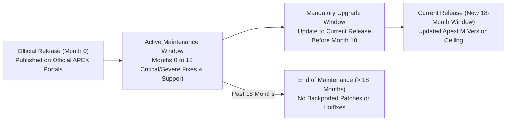

# Software Release Policies, Lifecycle & Distribution

This section defines **APEX Testing Technologies, Inc.** (**APEX**) software distribution standards, the **18-month version maintenance lifecycle**, mandatory hardware/OS requirements, technical support procedures, and the **Software License Agreement (SLA)** governing **APEX** applications, APIs/SDKs, and data formats.

---

## 1. Official Software Distribution Policy

- **Exclusive Official Sources**: All **APEX** installers, portable archives, hardware drivers, firmware utilities, runtime packages, developer SDKs (`DS-API`, `Phoenix API`), and license manager packages (`ApexLM`) are distributed **exclusively through official APEX channels** and downloadable from official **APEX** websites:
  - Main Website: **[https://apexturbine.com/](https://apexturbine.com/)**
  - Authenticated Customer & Maintenance Portal: **[https://users.apexturbine.com/](https://users.apexturbine.com/)**
  - Official Documentation Portal: **`https://apexdocs.apexturbine.com/`**
- **Prohibition of Unofficial Redistribution**: Third-party download mirrors, unverified file-sharing portals, and unauthorized redistribution of APEX software installers, shared libraries, or license manager binaries are strictly prohibited and not covered by APEX warranty or support.
- **Package Authenticity & Integrity**: Official APEX Windows installers and binaries are digitally signed; APEX Format Version 2 license documents are cryptographically verified via Ed25519 signatures.

---

## 2. 18-Month Release Lifecycle & Update Requirement

Every released version of **APEX** software is actively maintained for **no more than 18 months** from its official release date. To maintain technical support coverage, defect fixes, security/runtime updates, and compatibility with supported operating systems and hardware drivers, customers must follow a continuous **18-month update cycle**.

### Lifecycle Policy Rules

1. **Maximum 18-Month Version Maintenance Cap**: No released version of any APEX application suite (`DS`, `DX`, `GageMap`, `DX+`), hardware driver package, SDK (`DS-API`, `Phoenix API`), or `ApexLM` daemon is maintained beyond **18 months** from its initial release date.
2. **Mandatory 18-Month Update Period**: End-user organizations must upgrade production workstations, test-cell acquisition chassis, and central license servers to a current APEX release at least once every **18 months**.
3. **No Legacy Backports**: Defect resolutions (`CRITICAL`, `SEVERE`, or `IMPORTANT`), operating-system compatibility updates, and security patches are delivered exclusively in current releases within their 18-month window — patches are never backported to versions older than 18 months.
4. **Alignment with Software Maintenance & `ApexLM` Version Ceilings**:
   - Maintaining an uninterrupted **Software Maintenance Agreement** entitles your organization to download every official release and maintenance update issued during your coverage period.
   - Because **APEX License Manager (`ApexLM`)** licenses validate software versions (`YYYY.MM` ceiling), renewing Maintenance ensures updated Format v2 license keys are issued so upgraded software within the 18-month update cycle launches seamlessly. See [Software Maintenance & Support Policy](maintenance-and-support.md).

---

## 3. Release Channels & Pre-Release Builds

| Build Designation | Distribution Channel | Built-In Expiration / Usage Scope |
| :--- | :--- | :--- |
| **Production Release** | Official APEX Website & User Portal | Maintained up to **18 months** from release date; authorized for full production test-cell and engineering deployment with perpetual or term license keys. |
| **Release Candidate (`RC`)** | Controlled Customer Validation | Pre-release validation build carrying an automatic **21-day** build-date expiration check. Intended for pre-deployment qualification prior to Production Release. |
| **Beta Build** | Early Access / Specific Defect Triage | Diagnostic/evaluation build carrying a **60- or 62-day** build-date expiration. |
| **Alpha Build** | Internal / Engineering Evaluation Only | Rapid prototype build carrying a **14-day** build-date expiration; not warranted for production acquisition. |

---

## 4. Legacy FLEXlm / `lmgrd` Discontinuation (October 2027)

> [!WARNING]
> **Mandatory Licensing Platform Transition — October 2027**
>
> All legacy licensing technologies built on **FLEXlm / FlexNet Publisher (`lmgrd` license server daemon, `lmtools`, `lmutil`, legacy `.lic` files, `27000@host`, and OpenCode Trusted Storage)** will be **permanently discontinued as of October 2027**.
>
> - **All product versions going forward** use the unified **APEX License Manager (`ApexLM`)** platform (**APEX LM Daemon**, **APEX LM Server Daemon**, loopback Web Admin UI, `ApexLM_CLI`, and `ApexLM_Server_CLI`).
> - Customers must migrate workstation licenses and central floating license servers to **ApexLM** Format Version 2 licenses ahead of October 2027. See **[APEX License Manager Documentation](../License%20Manager/README.md)** and the **[Quick Start Guide](../License%20Manager/quick-start.md)**.

---

## 5. Policy & Compliance Index

- **[System Requirements, CPU Architectures & OS Support](system-requirements.md)** — Mandatory 64-bit `x86-64` and **`AVX2`** requirements, workload-tiered RAM/CPU/storage recommendations, Windows primary support, and per-product Linux support matrix.
- **[Software Maintenance & Support Policy](maintenance-and-support.md)** — Maintenance terms, renewal/reinstatement rules, APEX User Portal ticketing, emergency phone support (`+1 (931) 486-0082`), error classifications (`CRITICAL` / `SEVERE` / `IMPORTANT`), and guaranteed response/resolution schedules.
- **[Software License Agreement (SLA)](software-license-agreement.md)** — Exhaustive end-user software license terms, **non-commercial API/SDK restrictions**, **non-commercial APEX data-format & protocol restrictions**, intellectual property protections, warranties, indemnification, and governing law.
