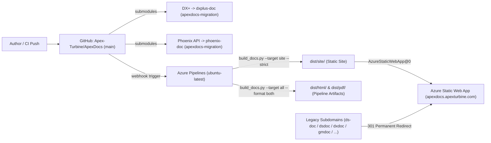

# ApexDocs Deployment, Compilation, and Pipelines

This section documents how the unified **APEX Documentation** (`ApexDocs`) repository is structured, compiled locally to standalone HTML and PDF deliverables, built and deployed automatically via **Azure Pipelines** to **Azure Static Web Apps**, maintained across **GitHub submodules**, and migrated from legacy product documentation subdomains (`ds-doc.apexturbine.com`, `dsdoc.apexturbine.com`, and companion single-product subdomains) to **`apexdocs.apexturbine.com`**.

## Contents

1. [Compiling Documentation Locally (HTML & PDF)](building-and-compiling.md) — Python prerequisites, MkDocs Material static builds, and per-product Playwright PDF generation on Windows and Linux.
2. [GitHub Structure & Submodule Workflow](submodules-and-github.md) — Repository layout under `github.com/Apex-Turbine`, working with the `DX+` (`dxplus-doc`) and `Custom Development/Phoenix API` (`phoenix-doc`) submodules, and promoting the `apexdocs-migration` branches.
3. [Azure Pipelines & Azure Static Web Apps](azure-pipelines-and-swa.md) — CI/CD pipeline stages, artifact publishing (`ApexDocs-PDFs`, `ApexDocs-Standalone-HTML`, `ApexDocs-StaticSite`), deployment secrets, and DNS setup.
4. [Legacy Domain Redirect Guide (`ds-doc.apexturbine.com` -> `apexdocs.apexturbine.com`)](url-redirects-guide.md) — Architectural recommendations, Bluehost DNS findings, path-preserving 301 Azure Static Web Apps redirect configuration, and legacy redirect deployment templates.

## Deployment Architecture

